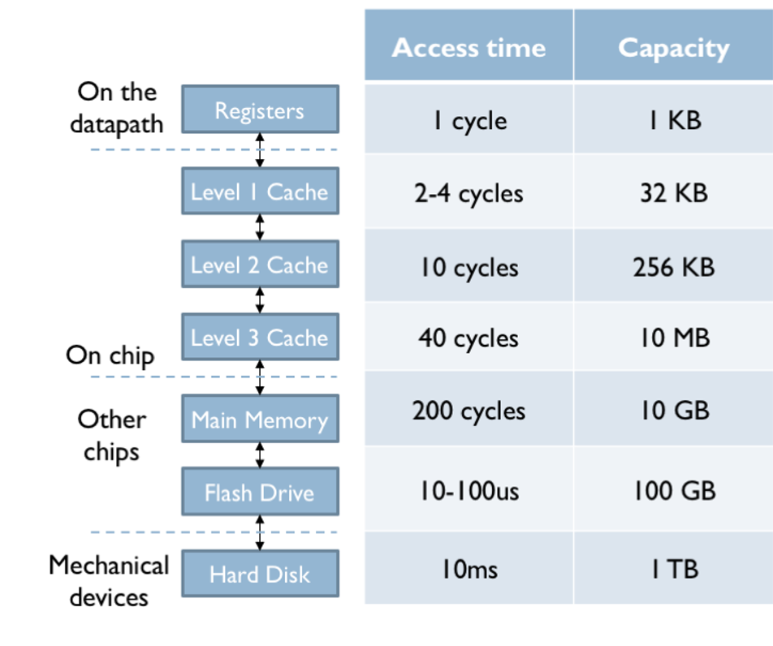

## Admin
:::{.nonincremental}
- Deadlines...
- Mid-semester survey on Canvas
:::

# Handling deadlocks {background-color="#40666e"}

## Deadlock avoidance
- All of the prevention techniques can be heavy-handed, reducing concurrency and overall system throughput
- What if we had more information about process resource needs before allocation?
  - Could we make smarter decisions about resource allocation?
- This is the idea behind deadlock avoidance

## Avoidance via resource-allocation graph
:::: {.columns}
::: {.column width="65%"}
- Introduce the idea of a [claim edge]{.alert} (dashed line) from a process to a resource
  - Indicates that the process may request that resource in the future
- The system can maintain this graph, and only grant resources that will not create a cycle
  - e.g., if T3 requests R2, granting it would create the cycle T1 ⇢ R2 → T3 ⇢ R1 → T1, so it must wait
- Any downsides / limitations?
  - Overhead of maintaining the graph and checking for cycles
  - Only applicable to single instance resources
:::
::: {.column width="2%"}
:::
::: {.column width="33%"}
```{dot}
//| fig-width: 3.5
digraph {
  graph [layout=neato, bgcolor=transparent, splines=true]
  node  [fontname="Helvetica", fontsize=16]
  edge  [fontname="Helvetica", fontsize=14, color=gray40, fontcolor=gray40]
  T1 [label="Thread 1", shape=circle, width=1.2, fixedsize=true, pos="0,1.4!"]
  T3 [label="Thread 3", shape=circle, width=1.2, fixedsize=true, pos="2.8,1.4!"]
  R1 [label="Resource 1", shape=box, pos="1.4,2.8!"]
  R2 [label="Resource 2", shape=box, pos="1.4,0!"]
  R1 -> T1 [label="held by"]
  T3 -> R1 [label="may request", style=dashed, color=black, fontcolor=black]
  T1 -> R2 [label="may request", style=dashed, color=black, fontcolor=black]
  T3 -> R2 [label="may request", style=dashed, color=black, fontcolor=black]
}
```
:::


::::

## Deadlock avoidance in practice
- Dijkstra's Banker's algorithm is the textbook example — each process declares its max resource needs, and requests are only granted if the resulting state is "safe." Not used in practice: overhead plus the prescience requirement
- Resource-allocation graph with claim edges sees occasional use in constrained settings (e.g., embedded systems where needs are predictable)

## Detecting and recovering from deadlock
- Allow deadlocks to occur, then detect and recover
- In some cases, recovery is pretty simple. If your machine froze once per year (maybe it does?) what would you do?
  - Reboot
- What scenarios do you think complex detection and recovery would make sense?
  - Systems with high availability requirements where manual intervention is costly or impractical
    - telecommunications systems, financial transaction systems, healthcare systems
    - critical infrastructure systems

## Detection
- Use a wait-for graph: a simplified resource-allocation graph that removes resource nodes
  - An edge from process $P_i$ to $P_j$ indicates that $P_i$ is waiting for a resource held by $P_j$
  - A cycle in this graph indicates a deadlock
  - $O(n^2)$ algorithm to search for cycles (beyond the cost of maintaining the graph itself)
  - Only applies to single instance resources

## Detection (cont'd)
:::: {.columns}
::: {.column width="48%"}
Resource-allocation graph

```{dot}
//| fig-width: 5
digraph {
  graph [layout=neato, bgcolor=transparent, splines=true]
  node  [fontname="Helvetica", fontsize=16]
  edge  [color=gray40]
  P0 [shape=circle, width=0.7, fixedsize=true, pos="0,2.6!"]
  P1 [shape=circle, width=0.7, fixedsize=true, pos="1.6,3.9!"]
  P2 [shape=circle, width=0.7, fixedsize=true, pos="1.6,1.3!"]
  P3 [shape=circle, width=0.7, fixedsize=true, pos="3.2,2.6!"]
  P4 [shape=circle, width=0.7, fixedsize=true, pos="4.8,3.9!"]
  P5 [shape=circle, width=0.7, fixedsize=true, pos="6.4,2.6!"]
  P6 [shape=circle, width=0.7, fixedsize=true, pos="3.2,0!"]
  R1 [shape=box, width=0.7, height=0.55, fixedsize=true, pos="0,3.9!"]
  R2 [shape=box, width=0.7, height=0.55, fixedsize=true, pos="1.6,2.6!"]
  R3 [shape=box, width=0.7, height=0.55, fixedsize=true, pos="4.8,2.6!"]
  R4 [shape=box, width=0.7, height=0.55, fixedsize=true, pos="3.2,1.3!"]
  R5 [shape=box, width=0.7, height=0.55, fixedsize=true, pos="6.4,1.3!"]
  R6 [shape=box, width=0.7, height=0.55, fixedsize=true, pos="1.6,0!"]
  edge [color=black, penwidth=2]
  P0 -> R2; P1 -> R2; P2 -> R2; P3 -> R3; P4 -> R3; P5 -> R5; P6 -> R4
  edge [color=gray40, penwidth=1]
  R1 -> P1; R2 -> P3; R3 -> P5; R4 -> P3; R5 -> P6; R6 -> P2
}
```
:::
::: {.column width="4%"}
:::
::: {.column width="48%" .fragment}
Wait-for graph

```{dot}
//| fig-width: 5
digraph {
  graph [layout=neato, bgcolor=transparent, splines=true]
  node  [fontname="Helvetica", fontsize=16]
  edge  [color=gray40]
  P0 [shape=circle, width=0.7, fixedsize=true, pos="0,2.6!"]
  P1 [shape=circle, width=0.7, fixedsize=true, pos="1.6,3.9!"]
  P2 [shape=circle, width=0.7, fixedsize=true, pos="1.6,1.3!"]
  P3 [shape=circle, width=0.7, fixedsize=true, pos="3.2,2.6!"]
  P4 [shape=circle, width=0.7, fixedsize=true, pos="4.8,3.9!"]
  P5 [shape=circle, width=0.7, fixedsize=true, pos="6.4,2.6!"]
  P6 [shape=circle, width=0.7, fixedsize=true, pos="3.2,0!"]
  P0 -> P3; P1 -> P3; P2 -> P3; P4 -> P5
  edge [color=black, penwidth=2]
  P3 -> P5; P5 -> P6; P6 -> P3
}
```
:::
::::

::: {.notes}
Ask students to build the wait-for graph before revealing it: for each request edge P -> R, add P -> (holder of R).

Cycle P3 -> P5 -> P6 -> P3 means P3, P5, P6 are deadlocked. P0, P1, P2 (waiting on P3) and P4 (waiting on P5) aren't in the cycle but are stuck forever anyway, since they wait on deadlocked processes. Good question: does killing P0 help? (No.) Which single process would you kill? (Any of P3, P5, P6; P3 frees the most since it also holds R2.)
:::

## Detection (cont'd)
- For multiple instance resources, we can use an algorithm similar to the Banker's algorithm to detect deadlock
- Question: How often should we run the detection algorithm?
  - Too often: wasteful overhead
  - Not often enough: long delays before recovery
  - What if we run it when a process requests a resource?
    - Could allow us to assign blame for deadlock to the requesting process
  - Heuristically (CPU utilization, etc.)
    - Less overhead, but harder to assign blame

## Recovery options
- Process termination
  - Abort all deadlocked processes (brute force)
  - Abort one process at a time until deadlock is resolved
    - How to choose which process to abort?
      - Priority, time running, resources used, etc.
- Resource preemption
  - Temporarily take resources away from some processes and give to others until deadlock is resolved
  - Highly dependent on the resource type
  - Rollback problem - processes may need to be rolled back to a safe state before resources can be reallocated
  - Starvation problem - same victims may be chosen repeatedly

## Pick the policy
:::{.nonincremental}
- For each system below, which deadlock strategy fits best — and **why**?
  1. Flight control software on a commercial aircraft
  2. A university course-registration system during peak enrollment
  3. Your personal laptop running a browser, editor, and Slack
- For your pick, name the cost you're accepting (lost concurrency? overhead? user-visible failures?)
:::

:::{.notes}
Goals: get them to weigh contention, cost of failure, and predictability. Push back hard if anyone picks avoidance — it's almost never the right answer outside narrow embedded niches.

- (1) Prevention via strict resource/lock ordering. Failure cost is catastrophic, workloads are well-characterized, throughput is secondary. (Students may say "avoidance" — push them: who declares max needs? what's the runtime cost on every request?) Cost accepted: lost concurrency (threads sometimes grab locks earlier or hold them longer than needed to respect the order) and design/verification effort to define and audit the ordering across the whole codebase.
- (2) Detection and recovery: the DB builds a wait-for graph and aborts one transaction when it finds a cycle; the client retries. Application code can also lock rows in a consistent order (e.g., by primary key) to make deadlocks rarer. Contention is high, but an aborted transaction is cheap to recover from. Cost accepted: user-visible failures (a student sees "please try again"), wasted work from rolled-back transactions, and overhead of building and checking the wait-for graph.
- (3) Ostrich. Deadlocks rare; reboot/kill is cheap; users won't tolerate any added overhead. Cost accepted: an occasional hang the user has to fix by force-quitting an app or rebooting, possibly losing unsaved work.

Push them on: "what changes your answer?" — e.g., what if the laptop runs medical software?
:::

## {background-color="#6E404F"}
::: {.r-fit-text}
What isn't clear?

Comments? Thoughts?
:::


# Memory Fundamentals {background-color="#40666e"}

## Questions to consider
:::{.nonincremental}
- What are the requirements for memory that the OS must accomplish?
- What abstraction should the OS provide to processes?
- Why does a memory hierarchy exist, and what forces does it create for the OS?
:::

## Memory overview
- Memory is required by all processes
- What users (developers) want:
  - Infinite space, private, fast, and cheap
- Reality: All memory is limited, only some is fast (and $$$), others are slow (but $)
  - Creates a [memory hierarchy]{.alert}
  - Small, fast, expensive (registers, cache, RAM) → Large, slow, cheap (ssd, disk, tape)
  - In order to support multiprogramming we must share and utilize memory hierarchy intelligently

## Memory hierarchy


## Memory preliminaries
- Remember: A process's code & data must both be in memory
  - CPU must fetch both as part of its instruction-execution cycle
- What memory can a CPU access directly?
  - Registers, caches, RAM
  - Therefore, any data or instruction must be in these direct access devices in order to operate on them
- In this discussion we're focusing on RAM (caches + registers are hardware problems)
- Memory is an array of words (width of memory), *kind of*

## Memory requirements
- What does the OS need to provide?
- Old days?
  - Just the OS libraries and a single process got the rest of the system memory
- Between multiple processes? Processes and the kernel?
  - [Transparency]{.alert}: we don't want processes to be aware of the virtualization.
    - They need to be presented with a simple address space
  - [Efficiency]{.alert}: memory is expensive and scarce
    - Need to be efficient in both space and time
  - [Protection / isolation]{.alert}: we need to ensure that processes can't access other process's address space (or the kernel's)

## Memory requirements (cont'd)
- From a process point of view how should we address things?
  - Abstraction, we need an **address space**
- We present an address space to processes that is their unique view of the system memory
  - Code, Heap, Stack, etc.
  - Process sees fake (virtual) addresses
  - Q: We know that heap & stack grow towards one another. How does it work when we have multiple threads?

## {background-color="#6E404F"}
::: {.r-fit-text}
What isn't clear?

Comments? Thoughts?
:::

# Memory Abstraction {background-color="#40666e"}

## Questions to consider
:::{.nonincremental}
- How can the OS provide isolation between processes?
- What are the trade-offs in when we bind virtual addresses to physical addresses?
- How can hardware help the OS manage memory efficiently?
:::

## Base and bounds
- Okay, we're going to lie to processes. How should we achieve this abstraction?
- First approach: base and bounds (or base and limit) registers
  - Base: smallest address; bounds: size of address space
  - This can help with protection / isolation
  - Where should the values be stored?
  - The CPU needs to check for every memory access
    - Stored in the PCB (we just added state that a context switch needs to account for)

## Base and bounds (cont'd)
- What will the OS need to keep track of?
  - When a process is first run
    - Need to find space for it (i.e., must be tracking free space)
  - When a process terminates
    - Return used memory to the free list
    - Clean up any data structures used to manage memory
  - On context switch?
    - CPU only has one set of base and bounds registers
  - When OS wants to relocate a process
    - Set new registers
  - When a process tries to address outside of its bound?
    - exception handlers

## Base and bounds (cont'd)
- Base and bounds is simple, but has some issues:
  - [External fragmentation]{.alert}: over time, as processes are loaded and unloaded, we can end up with slivers of memory that are not usable for new processes
  - [Relocation is expensive]{.alert}: moving a process in memory requires copying all of its data
- To address these issues, we can use more sophisticated memory management techniques, such as paging and segmentation

## Memory address binding
- When does the OS bind virtual addresses to physical addresses?
  - [Compile time]{.alert}: if we know where the process will be loaded, we can bind addresses at compile time
    - Not flexible
    - if you need to change anything, you need to recompile
  - [Load time]{.alert}: we can bind addresses when the process is loaded into memory
    - More flexible, but still not ideal
    - If you need to move the process, you need to reload it
  - [Runtime]{.alert}: we can bind addresses during execution, which allows for maximum flexibility and is the most common approach
    - Requires some help

## Runtime address binding
- To support runtime address binding, we need to use a [memory management unit (MMU)]{.alert}
  - Hardware component that translates virtual addresses to physical addresses on-the-fly
  - Can also provide protection by checking access rights and ensuring that processes cannot access memory outside of their allocated space
- The OS needs to maintain a data structure (e.g., page table) that the MMU can use for translation
- This allows processes to have a uniform address space (e.g., starting at 0 and going to "max")

## {background-color="#6E404F"}
::: {.r-fit-text}
What isn't clear?

Comments? Thoughts?
:::

