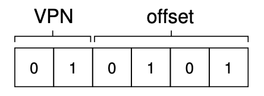
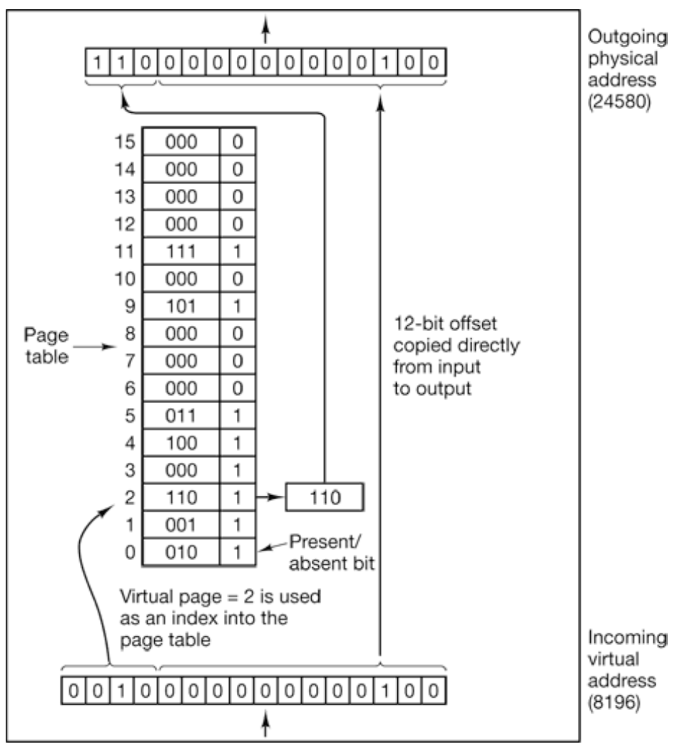

## Admin
:::{.nonincremental}
- Exam 2 next week
- Assignment 3 posted
:::

# Paging {background-color="#40666e"}

## Questions to consider
:::{.nonincremental}
- How does paging eliminate external fragmentation while supporting multiple processes?
- How does the hardware (MMU) translate virtual addresses to physical addresses?
- What information must the OS maintain to support paging?
:::

## Paging
- Contiguous allocation has many issues; what should we do?
  - Be non-contiguous!
- [Paging]{.alert}: split memory into fixed-size blocks
  - Eliminates external fragmentation
  - Needs hardware support (MMU) to translate addresses via a page table

::: {.notes}
Being non-contiguous introduces many new challenges of its own, which is most of what the next few lectures are about.
:::

## Paging (cont'd)
- Jargon!
  - Physical memory: **frames**
  - Logical memory: **pages**
  - Backing store: **blocks**
- Paging maps pages to frames
- Pages are logically contiguous; frames and blocks need not be
- Typically |frames| = |pages| = |blocks|
  - Most common: 4KB

::: {.notes}
- All three are fixed-size regions, and the backing store is addressed in fixed-size blocks too.
- Page sizes range from 512B to 64KB (64KB is an option on ARM64). Huge pages go to 2MB or 1GB.
:::

## Paging (cont'd)
:::: {.columns}
::: {.column width="58%"}
- Addresses have two parts: [page number]{.alert} and [page offset]{.alert}
  - Page number: index to a page
  - Offset: byte within that page
- Processes use virtual addresses. Which part do we translate?
  - Page number only; offset stays the same
:::
::: {.column width="2%"}
:::
::: {.column width="38%"}

:::
::::

## Paging (cont'd)
- The [page table]{.alert} maps virtual page numbers to physical frames
  - The MMU uses it on every memory access
- Transparent to the process; the OS controls the page table
- One page table *per process*
  - Where should it be stored?
  - In memory; pointer held in the PCB

::: {.notes}
- The page table can be any of several data structures. We'll see a few in the last section.
- Keeping the pointer in the PCB means one more thing to deal with on a context switch.
:::

## Page tables
:::: {.columns}
::: {.column width="58%"}
- Address space $2^m$ bytes, page size $2^n$ bytes
  - High $m-n$ bits: page number
  - Low $n$ bits: offset
- This example: $2^4$ = 16 pages, $2^{12}$ = 4KB pages
:::
::: {.column width="2%"}
:::
::: {.column width="38%"}

:::
::::

::: {.notes}
- In this example, 12 offset bits address all 4096 bytes within a page.
:::

## Examples
- 32-bit virtual address, 8-bit offset. How many pages? Page size? Total size?
  - $2^{24}$ (~16M) pages, 256B pages, 4GB total
- 256 pages, 8KB each
  - 8-bit index, 13-bit offset, 21 bits = 2MB total

## Translate an address
:::{.nonincremental}
- 16-bit virtual addresses, 4KB pages
- Page table:

| Page | Frame |
|------|-------|
| 0 | 2 |
| 1 | 5 |
| 2 | not present |
| 3 | 1 |

- Translate: **0x1A3F**, **0x3FFF**, **0x2004**
:::

::: {.notes}
First step: 4KB = $2^{12}$, so the low 12 bits (3 hex digits) are the offset and the top 4 bits (1 hex digit) are the page number. That's why hex is convenient here.

- 0x1A3F: page 1, offset 0xA3F. Frame 5, so **0x5A3F**
- 0x3FFF: page 3, offset 0xFFF (last byte of the page). Frame 1, so **0x1FFF**
- 0x2004: page 2, which isn't present: **page fault**. The OS has to bring the page in (or kill the process if the address is invalid).

Points to draw out: only the page number changes and the offset is copied straight through. The present bit is what turns a lookup into a fault. Pages 4–15 aren't shown; assume they're not present.
:::

## Page tables (cont'd)
- Page size depends on system usage
  - Smaller: finer granularity, but bigger page table
  - Larger: fewer, bigger disk transfers and fewer TLB misses
- How do pages affect fragmentation?
  - **No external fragmentation**
  - But now [internal fragmentation]{.alert}
  - On average: $1/2$ page per process

::: {.notes}
Internal fragmentation happens unless a process uses exactly a multiple of the page size. The last page is, on average, half empty.
:::

## Page table entries
- What goes into a page table entry?
  - Page frame number (duh)
  - [Present/absent]{.alert}: is the frame number valid?
  - [Protection]{.alert}: what access is allowed
  - [Modified/Dirty]{.alert}: written since loaded?
  - [Referenced]{.alert}: used recently?
  - [Caching disabled]{.alert}: bypass the cache?
- What doesn't go in?
  - Where the page lives on disk
    - Only what the hardware needs for translation

::: {.notes}
- A dirty page must be written to disk before eviction. The referenced bit drives eviction decisions.
- Caching disabled is for pages mapped to device registers (memory-mapped I/O). The CPU must read the device every time, not a stale cached copy.
- The disk location of a non-resident page is kept in the OS's own data structures (swap or VM bookkeeping), not in the hardware page table.
:::

## Size the page table
:::{.nonincremental}
- Assume 4 KB pages and 4-byte page table entries. How big is a single, flat page table for...
  1. A 32-bit address space?
  2. A 64-bit address space?
- 100 processes on the 32-bit machine — total memory just for page tables?
  - What does this tell you about storing page tables in RAM?
:::

:::{.notes}
Expected answers:

- 32-bit: $2^{32}/2^{12} = 2^{20}$ entries × 4 B = **4 MB per process**
- 64-bit: $2^{64}/2^{12} = 2^{52}$ entries × 4 B = $2^{54}$ B = **16 PB per process**. That's absurd, and motivates why real 64-bit systems don't use the full 64 bits and why we need multi-level / inverted page tables. (Real 64-bit entries are 8 B, which doubles it to 32 PB.)
- 100 processes × 4 MB = **400 MB** just for page tables

What this tells us about storing page tables in RAM:

- 4 MB per process is already painful. A flat table must be contiguous in physical memory, and most of it is empty for typical processes (sparse address space).
- It scales with process count, not memory use. A process that touches 1 page still pays for the full 4 MB table.
- 64-bit is impossible flat: the table itself wouldn't fit in any machine. That forces a smarter structure.
- Conclusion: don't store the whole table densely. Use multi-level (only allocate the levels you need), inverted (size by physical RAM, not virtual), or hashed page tables.
:::

## Paging summary
- Pages allow us to:
  - Load processes at finer granularity
  - Avoid external fragmentation
  - Swap individual pages ("paging")
- New questions:
  - Which pages are in memory?
  - When we need a frame, which page goes?
  - Which pages are modified and need writing to disk?

## {background-color="#6E404F"}
::: {.r-fit-text}
What isn't clear?

Comments? Thoughts?
:::

# Page replacement {background-color="#40666e"}

## Questions to consider
:::{.nonincremental}
- What makes a good page replacement strategy, and why?
- How can we approximate optimal page replacement without knowing the future?
- What are the practical implementation challenges for different page replacement algorithms?
:::

## Page replacement
- Memory is full and a process needs a page: evict a frame ([page replacement]{.alert})
- The evicted page is the **victim**
- Costly: 1 I/O for a clean victim, 2 for a dirty one
- [Clean pages are preferred victims]{.alert}
  - Dirty pages need a write-back first
- Downside of evicting dirty pages?
  - Forces the write at the worst time
  - Dirty pages were recently active

::: {.notes}
- A clean (read-only or unmodified) victim can be evicted by simply overwriting the frame, with no disk write. We still need one read to bring in the new page.
- A dirty victim adds a write on top of an already expensive operation.
- The write happens while the process is stalled waiting. Batching dirty writes during idle time would be more efficient.
- Recent activity means a dirty page is likely to be needed again soon.
:::

## Page replacement algorithms: OPT
- Optimal (OPT): evict the page that *won't be used for the longest time*
- Impossible (like SJF), but a useful benchmark
- Example: 3 frames, this reference pattern:

{.fragment}

::: {.notes}
Conceptually, label each page with the number of instructions that will run before it's next referenced, and evict the one with the largest label.
:::

## Page replacement algorithms: FIFO
- First-In-First-Out (FIFO): evict the oldest page
- Downsides?
  - Ignores use: may evict important pages
- [Belady's anomaly]{.alert}: more frames can mean more page faults
- Try this pattern with 3 frames, then 4:

::: {.notes}
Why the anomaly happens: FIFO isn't a *stack algorithm*. With a stack algorithm (OPT, LRU), the pages held with n frames are always a subset of those held with n+1 frames, so adding frames can never add faults. FIFO has no such guarantee because it ignores use entirely.
:::

## Belady's anomaly
- FIFO lacks the stack property, so more frames can mean more faults
{.fragment}
- Number of page faults with 3 frames = 9
{.fragment}
- Number of page faults with 4 frames = 10

## Page replacement algorithms: LRU
- We can't see the future. What can we do?
  - Look at the past
- Least Recently Used (LRU): evict the page unused for the longest time
  - OPT looking backwards
  - The evicted page might be needed right away
{.fragment}
{.fragment}

## LRU (cont'd)
- LRU does not exhibit Belady's anomaly
- How can we implement LRU?
  - Timestamp per entry: space, plus a search
  - Ordered list: updates on every access
  - Both impractical without special hardware
- Approximate it with a **reference bit**
  - Set when the page is referenced
  - Cleared periodically

::: {.notes}
- LRU is a stack algorithm, which is why it's immune to Belady's anomaly.
- Timestamps: each entry gets an associated clock value, which wastes space and needs a search to find the oldest.
- Ordered list: less wasted space, but many pointer updates on *every* memory access to keep it current.
- Reference bits start at zero and are cleared periodically, e.g., on a timer interrupt.
:::

## Page replacement algorithms: others
- Second Chance: FIFO queue + reference bit
  - Bit 0: replace the page
  - Bit 1: clear it, move page to the back
  - Downside?
    - Constantly moving pages in the list
- Clock: same idea, circular list
  - Hand points at the oldest page
  - Bit 0: replace; bit 1: clear and advance
  - A good approximation of LRU

::: {.notes}
Clock avoids Second Chance's list shuffling. Pages stay put and only the hand moves.
:::

## Page replacement algorithms: others (cont'd)
- Least Frequently Used (LFU): evict lowest use count
  - Downside?
    - Heavy early use keeps a page forever
- Most Frequently Used (MFU): evict highest count
  - Downside?
    - Evicts the pages you use most
- Both are poor: expensive and don't approximate OPT

::: {.notes}
- LFU fix: *aging*. Periodically decay the counts so old use counts for less.
- MFU's rationale is that the page with the lowest count probably just arrived and hasn't been used yet. In practice, the heavily used pages it evicts are usually the ones needed again soon.
:::

## Page replacement algorithms: summary
- OPT is optimal but impossible; LRU approximates it well
- Many algorithms, with different performance and hardware needs
- e.g., Linux: active/inactive lists (2Q-like)
  - Driven by the hardware referenced bit
- Page replacement shows up at every level of the memory hierarchy
  - We focus on disk/RAM: the biggest gap in access time

::: {.notes}
- Linux keeps two lists approximating 2Q. Pages move between active and inactive based on the referenced (accessed) bit, with no per-access counters or timestamps. Since kernel 6.1, Linux also offers MGLRU (multi-generational LRU), which uses more than two lists.
- The same idea appears at different time scales (CPU caches, the TLB) and inside applications (database buffer pools, web caches).
:::

## {background-color="#6E404F"}
::: {.r-fit-text}
What isn't clear?

Comments? Thoughts?
:::
