## Admin
:::{.nonincremental}
-
:::

# Page replacement {background-color="#40666e"}

## Questions to consider
:::{.nonincremental}
- What makes a good page replacement strategy, and why?
- How can we approximate optimal page replacement without knowing the future?
- What are the practical implementation challenges for different page replacement algorithms?
:::

## Page replacement
- Memory is full and a process needs a page: evict a frame ([page replacement]{.alert})
- The evicted page is the **victim**
- Costly: 1 I/O for a clean victim, 2 for a dirty one
- [Clean pages are preferred victims]{.alert}
  - Dirty pages need a write-back first
- Downside of evicting dirty pages?
  - Forces the write at the worst time
  - Dirty pages were recently active

::: {.notes}
- A clean (read-only or unmodified) victim can be evicted by simply overwriting the frame, with no disk write. We still need one read to bring in the new page.
- A dirty victim adds a write on top of an already expensive operation.
- The write happens while the process is stalled waiting. Batching dirty writes during idle time would be more efficient.
- Recent activity means a dirty page is likely to be needed again soon.
:::

## Page replacement algorithms: OPT
- Optimal (OPT): evict the page that *won't be used for the longest time*
- Impossible (like SJF), but a useful benchmark
- Example: 3 frames, this reference pattern:

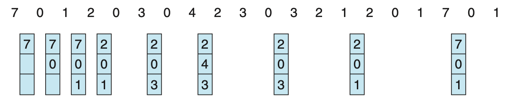{.fragment}

::: {.notes}
Conceptually, label each page with the number of instructions that will run before it's next referenced, and evict the one with the largest label.
:::

## Page replacement algorithms: FIFO
- First-In-First-Out (FIFO): evict the oldest page
- Downsides?
  - Ignores use: may evict important pages
- [Belady's anomaly]{.alert}: more frames can mean more page faults
- Try this pattern with 3 frames, then 4:
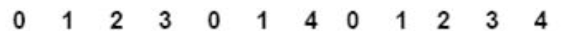

::: {.notes}
Why the anomaly happens: FIFO isn't a *stack algorithm*. With a stack algorithm (OPT, LRU), the pages held with n frames are always a subset of those held with n+1 frames, so adding frames can never add faults. FIFO has no such guarantee because it ignores use entirely.
:::

## Belady's anomaly
- FIFO lacks the stack property, so more frames can mean more faults
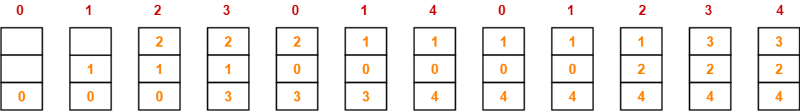{.fragment}
- Number of page faults with 3 frames = 9
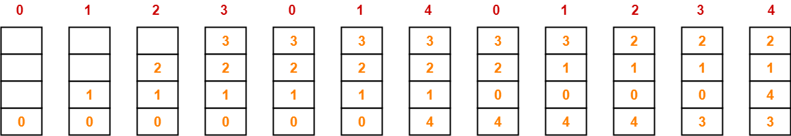{.fragment}
- Number of page faults with 4 frames = 10

## Page replacement algorithms: LRU
- We can't see the future. What can we do?
  - Look at the past
- Least Recently Used (LRU): evict the page unused for the longest time
  - OPT looking backwards
  - The evicted page might be needed right away
{.fragment}
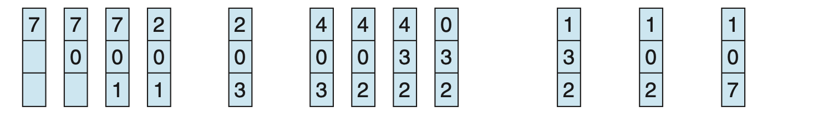{.fragment}

## LRU (cont'd)
- LRU does not exhibit Belady's anomaly
- How can we implement LRU?
  - Timestamp per entry: space, plus a search
  - Ordered list: updates on every access
  - Both impractical without special hardware
- Approximate it with a **reference bit**
  - Set when the page is referenced
  - Cleared periodically

::: {.notes}
- LRU is a stack algorithm, which is why it's immune to Belady's anomaly.
- Timestamps: each entry gets an associated clock value, which wastes space and needs a search to find the oldest.
- Ordered list: less wasted space, but many pointer updates on *every* memory access to keep it current.
- Reference bits start at zero and are cleared periodically, e.g., on a timer interrupt.
:::

## Page replacement algorithms: others
- Second Chance: FIFO queue + reference bit
  - Bit 0: replace the page
  - Bit 1: clear it, move page to the back
  - Downside?
    - Constantly moving pages in the list
- Clock: same idea, circular list
  - Hand points at the oldest page
  - Bit 0: replace; bit 1: clear and advance
  - A good approximation of LRU

::: {.notes}
Clock avoids Second Chance's list shuffling. Pages stay put and only the hand moves.
:::

## Page replacement algorithms: others (cont'd)
- Least Frequently Used (LFU): evict lowest use count
  - Downside?
    - Heavy early use keeps a page forever
- Most Frequently Used (MFU): evict highest count
  - Downside?
    - Evicts the pages you use most
- Both are poor: expensive and don't approximate OPT

::: {.notes}
- LFU fix: *aging*. Periodically decay the counts so old use counts for less.
- MFU's rationale is that the page with the lowest count probably just arrived and hasn't been used yet. In practice, the heavily used pages it evicts are usually the ones needed again soon.
:::

## Page replacement algorithms: summary
- OPT is optimal but impossible; LRU approximates it well
- Many algorithms, with different performance and hardware needs
- e.g., Linux: active/inactive lists (2Q-like)
  - Driven by the hardware referenced bit
- Page replacement shows up at every level of the memory hierarchy
  - We focus on disk/RAM: the biggest gap in access time

::: {.notes}
- Linux keeps two lists approximating 2Q. Pages move between active and inactive based on the referenced (accessed) bit, with no per-access counters or timestamps. Since kernel 6.1, Linux also offers MGLRU (multi-generational LRU), which uses more than two lists.
- The same idea appears at different time scales (CPU caches, the TLB) and inside applications (database buffer pools, web caches).
:::

## {background-color="#6E404F"}
::: {.r-fit-text}
What isn't clear?

Comments? Thoughts?
:::

# Page tables {background-color="#40666e"}

## Questions to consider
:::{.nonincremental}
- Why is page table size a critical concern for memory efficiency?
- How can hardware support (like the TLB) improve address translation performance?
- How does context switching interact with the TLB, and what mechanisms address the correctness and performance problems it creates?
:::

## Page table access
- Where is the page table stored?
  - Old: dedicated registers (doesn't scale)
  - Now: main memory, pointer in the PCB
- Downsides?
  - Large tables use a lot of memory
  - Two memory accesses per access
  - How do we speed this up?
    - Hardware

::: {.notes}
- The PCB pointer means the context switch has to swap which page table the MMU uses.
- Two accesses: one to read the page table entry and one for the actual data.
:::

## Translation lookaside buffer (TLB)
- Uses [associative memory]{.alert}
  - What's special about associative (content-addressable) memory?
    - *Parallel search*: all keys checked at once
- Key (tag)–value pairs: a cache for the page table
- **Expensive**, so only a small number of entries

## TLB (cont'd)
:::: {.columns}
::: {.column width="58%"}
- CPU issues a logical address (e.g., load from address 100)
- On a **miss**, fetch the entry from the page table
  - *Soft miss*: page is in memory
  - *Hard miss*: page is on disk (page fault)
:::

::: {.column width="2%"}
:::
::: {.column width="38%"}
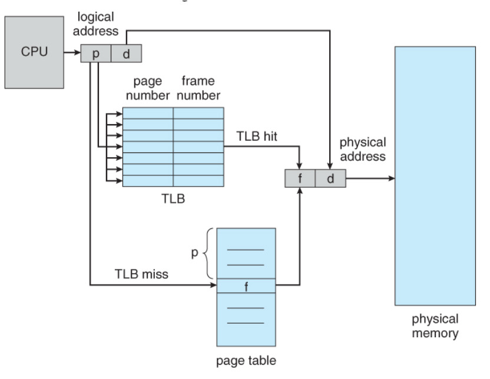
:::
::::

::: {.notes}
On a miss, the fetched entry may replace an existing TLB entry.
:::

## TLB (cont'd)
- On a **hit**, we get the physical address directly
  - Hit: 1 memory access; miss: 2
- Hit ratio sets the [effective access time]{.alert} (EAT)
- Example: 80% hits, 10ns per memory access
  - EAT = $(.8 \times 10) + (.2 \times 20) = 12ns$
  - 99% hits: $(.99 \times 10) + (.01 \times 20) = 10.1ns$
- Entries that must always stay (e.g., kernel)?
  - "Wired down": never replaced

::: {.notes}
- On a miss, the two accesses are one for the page table and one for the data.
- This EAT model treats TLB lookup time as negligible and assumes a single-level page table. With multi-level tables, a miss costs more memory accesses.
:::

## How good does the TLB need to be?
:::{.nonincremental}
- Memory access: 10ns. A perfect TLB gives EAT = 10ns
- What hit rate keeps EAT within 5% of perfect (≤ 10.5ns)?
  1. Single-level page table (a miss costs 2 accesses)
  2. 4-level page table (a miss costs 5 accesses)
:::

::: {.notes}
Let $h$ be the hit rate.

1. Single level: $10h + 20(1-h) = 20 - 10h \le 10.5$, so $h \ge$ **95%**
2. 4-level: a miss walks 4 tables and then reads the data, which is 5 accesses = 50ns. $10h + 50(1-h) = 50 - 40h \le 10.5$, so $h \ge$ **98.75%**

For comparison, the slide's 80% hit rate with a 4-level table gives $8 + 10 = 18ns$, almost twice the cost of a hit.

Points to draw out: deeper page tables save memory (coming up in the next section) but make every miss more expensive, so the TLB matters *more* as tables get deeper. This is why real TLBs hit well above 99%, and why CPUs add page-walk caches. Same caveats as before: TLB lookup time is ignored.
:::

## TLB (cont'd)
- Multiple processes, one small TLB. What happens on a context switch?
  - Process 1's virtual page 1 ≠ process 2's virtual page 1
- Could **flush** the TLB on every switch
  - Downside?
    - Lose the cache; rebuild it every time
- Other idea?
  - [Address-space identifiers]{.alert} (ASIDs): tag each TLB entry with its process

:::{.notes}
ASIDs prevent a process from accessing a page that doesn't belong to it, while letting pages from multiple processes coexist in the TLB.

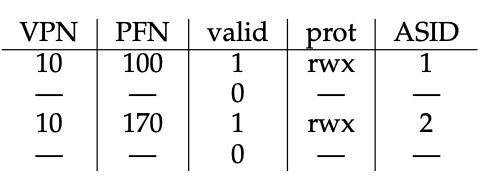
:::

## {background-color="#6E404F"}
::: {.r-fit-text}
What isn't clear?

Comments? Thoughts?
:::

# Exam 2 boundary {background-color="#907845"}

# Page table structures {background-color="#40666e"}

## Questions to consider
:::{.nonincremental}
- How can we organize page tables to handle large address spaces efficiently?
- What are the trade-offs between space overhead and lookup complexity?
- When and why would we choose alternative page table designs?
:::

## Page table structures
:::: {.columns}
::: {.column width="50%"}
- Linear page tables are wasteful, especially with many unused pages (likely)
- Answer?
  - Multilevel page tables
:::
::: {.column width="2%"}
:::
::: {.column width="48%"}
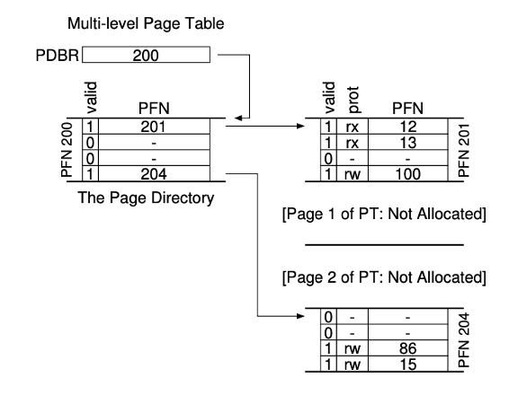{.fragment}
:::
::::

## The rule that drives everything

- [Each page table fits in one page]{.alert} (on x86 and most designs)
  - Page directory and every second-level table: one 4KB page each
  - One directory per process, plus a table per valid directory entry
  - Why? The paging system can manage page tables like any other page
- This constraint sets everything else:
  - entry size → entries per table → bits per level

::: {.notes}
- A page table is just another data structure stored in memory.
- Because each table is exactly one page, no special-case allocator is needed.
- Not universal: the 32-bit ARM first-level table is 16KB, and x86 PAE's top level is only 32 bytes. But one page per table is the common design and the one we'll use.
:::

## Multilevel page tables
:::: {.columns}
::: {.column width="50%"}
- Example: two-level page table
  - 10-bit PT1, 10-bit PT2, 12-bit offset
- Top level points to 1024 second-level tables
- Each second-level table maps 1024 4KB pages
:::
::: {.column width="2%"}
:::
::: {.column width="48%"}
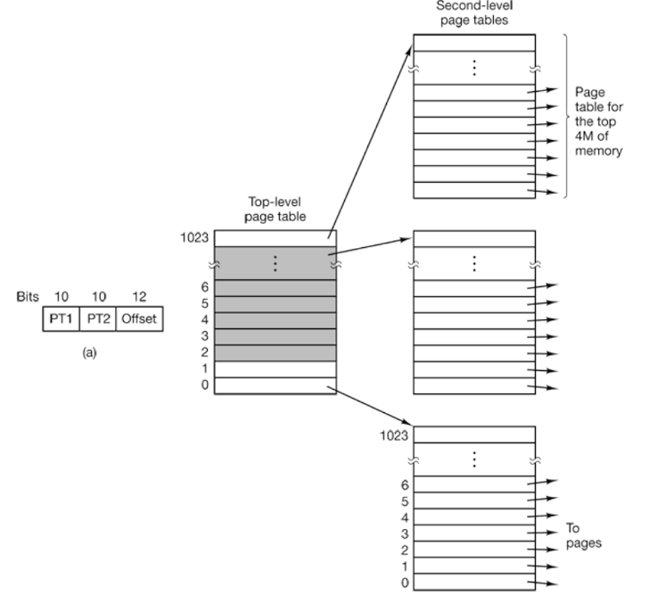
:::
::::
- Benefit?
  - Unused second-level tables needn't exist
  - Here: 4 tables (16KB), not 4MB

::: {.notes}
In this example all $2^{20}$ pages are still addressable, but only 4 tables are resident: the top level plus 3 second-level tables.
:::

## Two-level page table: address breakdown

| Field | Bits | Meaning |
|-------|------|---------|
| PT1 (dir index) | 10 | which page table |
| PT2 (page index) | 10 | which entry in that table |
| Offset | 12 | byte within page |

- **4-byte** entries → $4096 / 4 = 1024 = 2^{10}$ entries → **10-bit index**
- $2^{10}$ × 4B = 4KB = **exactly one page**
- Invalid directory entry: its page table **needn't exist**

::: {.notes}
Exactly one page is no accident. It's the rule from before.
:::

## Flat vs. two-level
:::{.nonincremental}
- 32-bit addresses, 4KB pages, 4-byte entries
- A process uses:
  - 4MB of code at the bottom of its address space
  - 1 page of stack at the very top
- How much memory do its page tables take with a flat table? With the two-level table above?
:::

::: {.notes}
- Flat: $2^{20}$ entries × 4 B = **4 MB**, regardless of how little the process uses.
- Two-level: each second-level table maps 1024 × 4KB = 4MB.
  - Code (0 to 4MB) is covered by exactly one second-level table (directory entry 0).
  - The stack page at the top needs one more (directory entry 1023).
  - Plus the directory itself: 3 tables × 4KB = **12 KB**.
- The other 1021 directory entries are marked invalid, so their tables don't exist.

Follow-up: what if the code were 4MB + 1 byte? It spills into a second table, giving 16KB total. Or the code is 4MB but starts at address 2MB instead of 0? It straddles two tables, also 16KB. Alignment matters.

Follow-up: what's the cost? Every TLB miss now takes two memory accesses to walk the table instead of one.
:::

## Multilevel page tables (cont'd)
:::: {.columns}
::: {.column width="40%"}
- Extends to more levels
- 64-bit doesn't use all 64 bits
  - x86-64: 48 bits, 256TB
:::
::: {.column width="2%"}
:::
::: {.column width="58%"}
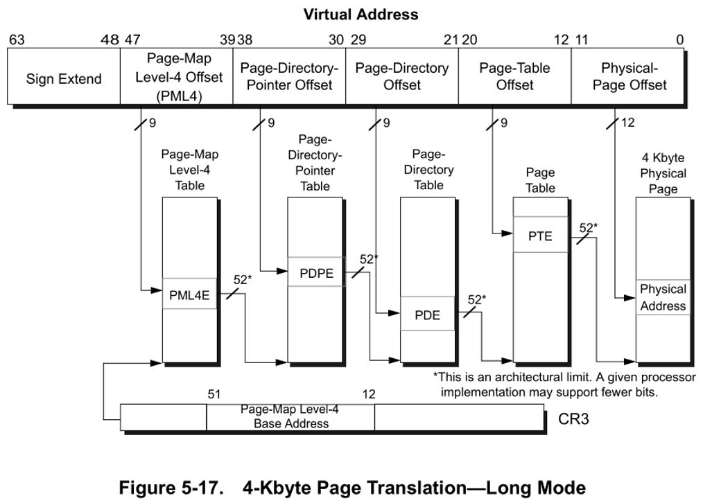
:::
::::

::: {.notes}
x86-64 uses 4 levels for 48 bits. Newer CPUs support 5-level paging with 57-bit addresses (128PB).
:::

## Inverted page tables
:::: {.columns}
::: {.column width="50%"}
- So far: one page table per process
- Alternative: one system-wide table, one entry per physical frame (**inverted page table**)
  - Entry: owning PID + virtual page number
:::
::: {.column width="2%"}
:::
::: {.column width="48%"}
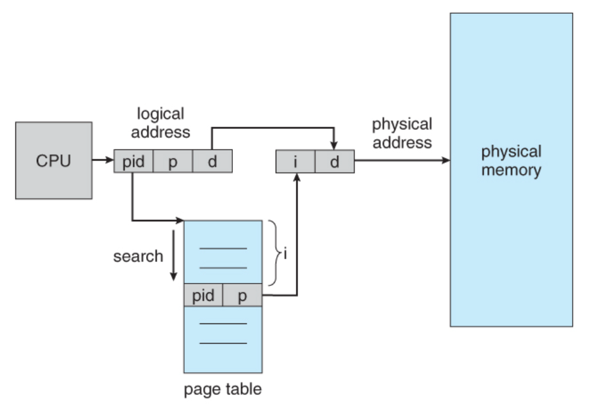
:::
::::

::: {.notes}
Each entry records which process owns the frame and which virtual page of that process is stored there. The table size scales with physical memory, not virtual address space.
:::

## Inverted page tables (cont'd)
- Smaller, but lookups are harder
  - Naive lookup searches the whole table (slow)
- Fix: hash table index, plus a TLB for frequent lookups
- Rare on mainstream x86 and ARM
  - Used by PowerPC and IA-64 (hashed tables)

::: {.notes}
- Multi-level tables won on x86 and ARM because they're simpler and handle sparse address spaces well.
- Inverted tables also make shared memory awkward, since each frame records only one virtual page.
:::

## {background-color="#6E404F"}
::: {.r-fit-text}
What isn't clear?

Comments? Thoughts?
:::

