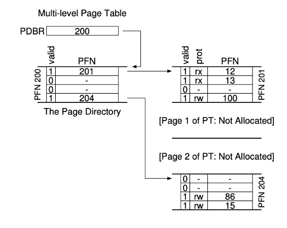
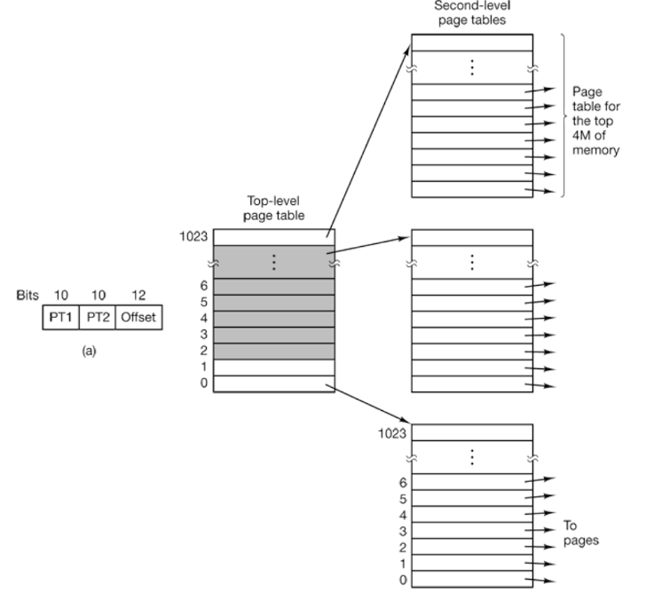
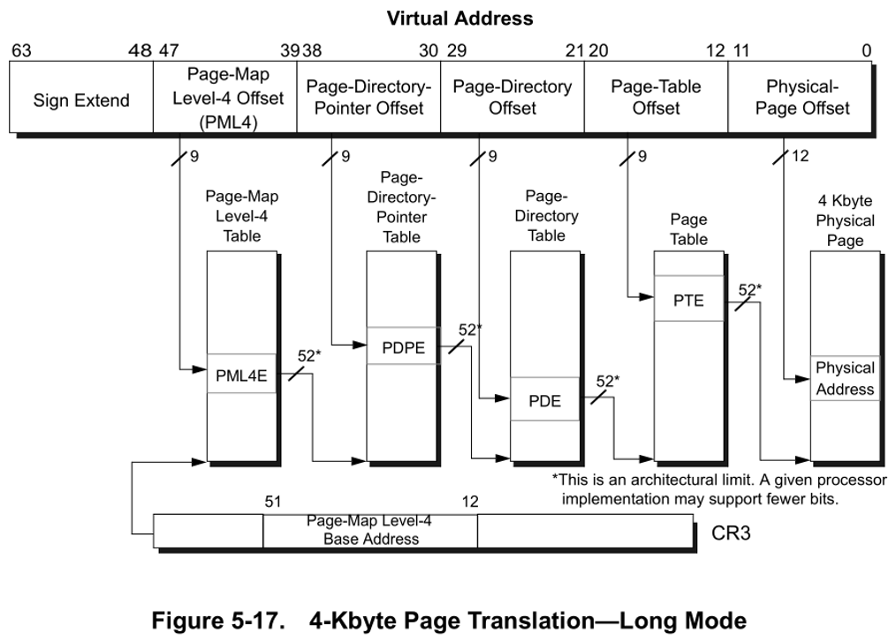
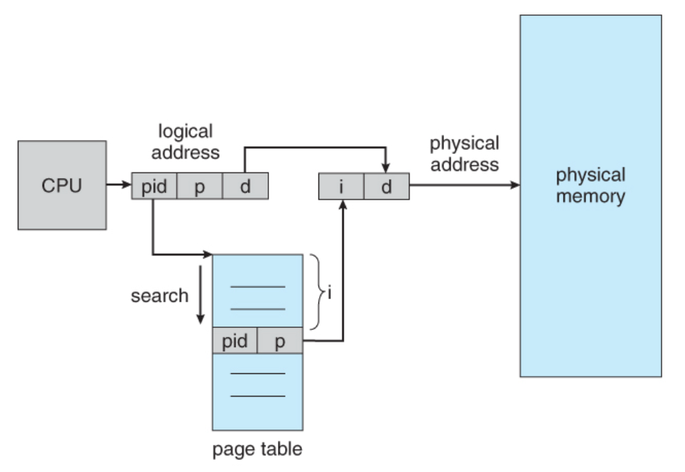
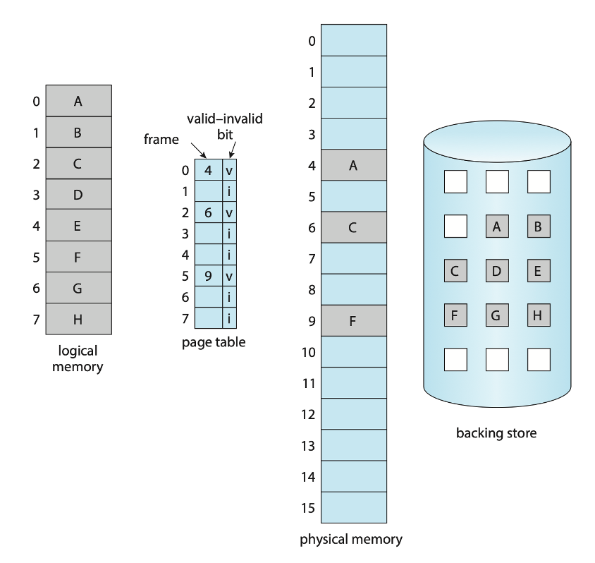
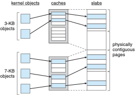

## Admin
:::{.nonincremental}
- Assignment 2 due next Wednesday
:::

# Page table structures {background-color="#40666e"}

## Questions to consider
:::{.nonincremental}
- How can we organize page tables to handle large address spaces efficiently?
- What are the trade-offs between space overhead and lookup complexity?
- When and why would we choose alternative page table designs?
:::

## Page table structures
:::: {.columns}
::: {.column width="50%"}
- Linear page tables are wasteful, especially with many unused pages (likely)
- Answer?
  - Multilevel page tables
:::
::: {.column width="2%"}
:::
::: {.column width="48%"}
{.fragment}
:::
::::

## The rule that drives everything

- [Each page table fits in one page]{.alert} (on x86 and most designs)
  - Page directory and every second-level table: one 4KB page each
  - One directory per process, plus a table per valid directory entry
  - Why? The paging system can manage page tables like any other page
- This constraint sets everything else:
  - entry size → entries per table → bits per level

::: {.notes}
- A page table is just another data structure stored in memory.
- Because each table is exactly one page, no special-case allocator is needed.
- Not universal: the 32-bit ARM first-level table is 16KB. But one page per table is the common design and the one we'll use.
:::

## Multilevel page tables
:::: {.columns}
::: {.column width="50%"}
- Example: two-level page table
  - 10-bit PT1, 10-bit PT2, 12-bit offset
- Top level points to 1024 second-level tables
- Each second-level table maps 1024 4KB pages
:::
::: {.column width="2%"}
:::
::: {.column width="48%"}

:::
::::
- Benefit?
  - Unused second-level tables needn't exist
  - Here: 4 tables (16KB), not 4MB

::: {.notes}
In this example all $2^{20}$ pages are still addressable, but only 4 tables are resident: the top level plus 3 second-level tables.
:::

## Two-level page table: address breakdown

| Field | Bits | Meaning |
|-------|------|---------|
| PT1 (dir index) | 10 | which page table |
| PT2 (page index) | 10 | which entry in that table |
| Offset | 12 | byte within page |

- **4-byte** entries → $4096 / 4 = 1024 = 2^{10}$ entries → **10-bit index**
- $2^{10}$ × 4B = 4KB = **exactly one page**
- Invalid directory entry: its page table **needn't exist**

::: {.notes}
Exactly one page is no accident. It's the rule from before.
:::

## Flat vs. two-level
:::{.nonincremental}
- 32-bit addresses, 4KB pages, 4-byte entries
- A process uses:
  - 4MB of code at the bottom of its address space
  - 1 page of stack at the very top
- How much memory do its page tables take with a flat table? With the two-level table above?
:::

::: {.notes}
- Flat: $2^{20}$ entries × 4 B = **4 MB**, regardless of how little the process uses.
- Two-level: each second-level table maps 1024 × 4KB = 4MB.
  - Code (0 to 4MB) is covered by exactly one second-level table (directory entry 0).
  - The stack page at the top needs one more (directory entry 1023).
  - Plus the directory itself: 3 tables × 4KB = **12 KB**.
- The other 1021 directory entries are marked invalid, so their tables don't exist.

Follow-up: what if the code were 4MB + 1 byte? It spills into a second table, giving 16KB total. Or the code is 4MB but starts at address 2MB instead of 0? It straddles two tables, also 16KB. Alignment matters.

Follow-up: what's the cost? Every TLB miss now takes two memory accesses to walk the table instead of one.
:::

## Multilevel page tables (cont'd)
:::: {.columns}
::: {.column width="40%"}
- Extends to more levels
- 64-bit doesn't use all 64 bits
  - x86-64: 48 bits, 256TB
  - 8-byte entries → 512 per table → 9-bit index
  - 9 + 9 + 9 + 9 + 12 = 48
:::
::: {.column width="2%"}
:::
::: {.column width="58%"}

:::
::::

::: {.notes}
x86-64 uses 4 levels for 48 bits. Same one-page-per-table rule as before; the entries are just twice as wide, so each level indexes with 9 bits instead of 10. Physical addresses go up to 52 bits (4PB). Newer CPUs support 5-level paging with 57-bit addresses (128PB).
:::

## Inverted page tables
:::: {.columns}
::: {.column width="50%"}
- So far: one page table per process
- Alternative: one system-wide table, one entry per physical frame (**inverted page table**)
  - Entry: owning PID + virtual page number
- Smaller, but lookup needs a hash table (plus the TLB)
- Rare on x86 and ARM; used by PowerPC and IA-64
:::
::: {.column width="2%"}
:::
::: {.column width="48%"}

:::
::::

::: {.notes}
Each entry records which process owns the frame and which virtual page of that process is stored there. The table size scales with physical memory, not virtual address space.
- Multi-level tables won on x86 and ARM because they're simpler and handle sparse address spaces well.
- Inverted tables also make shared memory awkward, since each frame records only one virtual page.
:::

## {background-color="#6E404F"}
::: {.r-fit-text}
What isn't clear?

Comments? Thoughts?
:::

# Loading pages {background-color="#40666e"}

## Questions to consider
:::{.nonincremental}
- A process's pages don't all fit in memory, and it doesn't need them all at once. Which pages do we load, and when?
- What does the OS do when a process touches a page that isn't in memory?
- What happens when the pages a process needs right now don't fit?
:::

## Demand paging
:::: {.columns}
::: {.column width="50%"}
- We can load pages into memory only when they are needed, which is called [demand paging]{.alert}
- Here we see why the valid bit is useful
  - Valid implies "allocated and in memory"
  - Invalid implies "not allocated or not in memory"
:::
::: {.column width="2%"}
:::
::: {.column width="48%"}

:::
::::

## Demand paging (cont'd)
- If process has a **page fault**, we trap to the OS, which
  1. checks the reference is legal (if not, kill the process)
  2. finds a free frame (if none, run page replacement to pick a victim)
  3. requests the block from the backing store or swap space
  4. brings the page into memory
  5. updates the page table
  6. restarts the faulting instruction
- Non-resident pages may have never been in memory (so in the file system) or were once resident and swapped out (to swap space)
- [Pure demand paging]{.alert}: start with no pages resident. Simple, but a burst of faults at startup

## Working set
- To mitigate the performance issues of pure demand paging, we can use the concept of a [working set]{.alert}
- Takes advantage of the principle of locality: processes tend to access a relatively small set of pages over a short period of time
- Working-set model:
  - Define a window $\Delta$ (most recent page references)
  - If a page is referenced within the window, it's in the working set; otherwise, it's not
- Allows for **prepaging**: when a process is swapped back in, bring its whole working set in at once instead of faulting each page in one at a time

## Thrashing
- If the working set of a process exceeds the available physical memory, the process will experience a high rate of page faults, leading to a condition called [thrashing]{.alert}
- When the page fault time exceeds the time spent executing, we are said to be thrashing
- Problem: CPU scheduler sees the decreasing CPU utilization and increases the degree of multiprogramming; makes thrashing *worse*
- Solutions?
  - [Local replacement algorithm]{.alert} (each process can only select victims from its set of allocated frames)
  - i.e. cannot steal frames from another process and cause the latter to thrash as well
  - [Decrease the degree of multiprogramming]{.alert} (reduce the number of processes)

::: {.notes}
Local replacement means a process can only evict its own frames; global means it can evict anyone's. Local limits the damage, but it doesn't fix the thrashing process itself. That's why most OSes stay with global replacement and instead watch the page-fault rate or working set to decide when to suspend a process.
:::

## Optimizing shared pages
- Same idea as demand paging: don't do the work until a page is actually needed
- Remember how fork() and exec() work?
  - Fork leads to a copy of the parent's address space
  - … but exec() means that a lot of children immediately replace, making a copy wasteful
- What should we do?
  - Share the pages initially
  - If either the parent or the child writes to the shared page, then you actually make a copy ([copy-on-write]{.alert})
  - Copy-on-write significantly speeds up fork operation; particularly if they will soon exec

## {background-color="#6E404F"}
::: {.r-fit-text}
What isn't clear?

Comments? Thoughts?
:::

# Real-World Memory {background-color="#40666e"}

## Questions to consider
:::{.nonincremental}
- How can we increase TLB reach without making the TLB itself larger?
- What memory security features does the OS and hardware provide to protect against attacks?
- Why does a discrete GPU need its own memory, and what changes when CPU and GPU share one pool?
:::

## TLB reach
- We've talked about the hit ratio of a TLB
  - Influenced by the size of the TLB
- Another metric: [TLB reach]{.alert} (i.e., how much memory is addressable from the TLB)
  - Num TLB entries * page size
  - Ideal world: entire working set for a process fits in the TLB
- It'd be great to simply grow the TLB, but that's expensive
- What else can we do?

## Huge pages
- As we discussed, page tables can be large, and TLBs are small. This can lead to a high TLB miss rate, which can significantly degrade performance.
- One solution is to use larger page sizes, known as [huge pages]{.alert}
- By using huge pages (e.g., 2MB instead of 4KB [can go up to 1GB]), we can reduce the number of pages, and thus the size of the page table, and increase the TLB hit rate
- Newer kernels support transparent huge pages, which automatically use huge pages when possible without requiring changes to applications
- Danger: internal fragmentation can be much worse with huge pages, so they are not ideal for all workloads

## Aside: where does a GPU get its memory?
- A graphics card has its own memory chips, called [VRAM]{.alert}
  - Separate chips, separate wires, separate address space
  - So a pointer from your program is [meaningless]{.alert} to the GPU; data is copied over [PCIe]{.alert} first
- Why a second pool? VRAM is built for [bandwidth]{.alert}: roughly 10x normal system RAM
  - The cost: fixed, small capacity, and every transfer is an explicit copy over a slower link
- OS angle: VRAM is *not* part of the pool of frames the kernel hands out

## Unified memory
- Apple silicon takes the opposite approach: [one]{.alert} pool, on the same package as the CPU
  - CPU, GPU, and Neural Engine all address it; a pointer means the same thing to each
  - No copy, because there's nowhere to copy *to*
- Connects to today: [16KB]{.alert} default pages (x86 uses 4KB)
  - Same number of TLB entries, so [4x the TLB reach]{.alert}, paid for in internal fragmentation, same as huge pages
- The tradeoff: capacity is fixed at purchase, and CPU and GPU compete for the *same* bandwidth

:::{.notes}
Why soldered? It's not just thinness or lock-in — it's what makes the bandwidth possible.

- A standard DIMM channel is 64 bits wide; dual-channel desktop is 128 bits, ~90-100 GB/s.
  Apple runs much wider buses (roughly 128-bit on a base chip up to ~512-bit on a Max),
  which is how you get into the hundreds of GB/s.
- Every one of those bits is a physical wire. You can't route that many traces through a
  socket with good length matching at modern speeds. The width requires the memory to sit
  right next to the controller.
- A socket is also an electrical discontinuity (stubs, reflections), so soldered
  point-to-point traces clock higher. And shorter traces = less energy per bit, which is
  most of why these laptops idle so well.
- Be honest about the other half: it also lets the vendor charge a lot for capacity
  upgrades. Both things are true at once. Good habit of mind: a real engineering
  justification and a convenient business consequence can coexist.
- Apple's is beyond soldered — the DRAM sits on the same *package* as the SoC, not just
  on the motherboard. Two degrees of the same tradeoff.

Backup, if someone asks whether this is a law of nature: no. LPCAMM2 (JEDEC standard,
grew out of Dell's CAMM work) is a socketed LPDDR5X module — it clamps flat against the
board instead of edge-connecting, so signal integrity is much better than SO-DIMM and the
memory is still upgradeable. Doesn't reach Apple-class bus widths, but it shows the
tradeoff is being engineered around.
:::

## Linux memory security
- Linux provides several features to enhance memory security, such as:
  - [Address Space Layout Randomization (ASLR)]{.alert}: randomizes the memory addresses used by a process, making it more difficult for attackers to predict where code or data is located
  - [Kernel Address Space Layout Randomization (KASLR)]{.alert}: randomizes the memory addresses used by the kernel
  - [Data Execution Prevention (DEP)]{.alert}: marks certain areas of memory as non-executable, preventing code from being executed from those regions (e.g., the stack)
    - NX bit: hardware support for DEP held in the page table entry

## {background-color="#6E404F"}
::: {.r-fit-text}
What isn't clear?

Comments? Thoughts?
:::

# Kernel memory management {background-color="#40666e"}

## Questions to consider
:::{.nonincremental}
- Why does the kernel need physically contiguous memory, and how does this differ from user-space allocation?
- How does the buddy system handle allocation and deallocation, and what are its trade-offs?
- Why is a slab allocator useful for small, frequently used kernel objects?
:::

## Linux kernel memory management
- Treated differently from user memory: structures of varying sizes, and some must be [physically contiguous]{.alert} (e.g., for device I/O)
- [Buddy system allocator]{.alert}: hand out blocks of size $2^k$
  - Request of size $s$: find the smallest $2^k \ge s$
  - Too big? Split into two "buddies" of size $2^{k-1}$, repeat
  - On free: if the buddy is also free, coalesce back into a larger block

## Buddy system allocator: tradeoffs
- Advantages?
  - Simple and efficient for allocating memory of varying sizes
  - Can quickly coalesce free blocks
- Disadvantages?
  - Fragmentation
    - Internal fragmentation: if a request is for 5KB, we need to allocate an 8KB block, wasting 3KB
    - External fragmentation: over time, as blocks are allocated and freed, we can end up with many small free blocks that cannot be coalesced into larger blocks, making it difficult to satisfy larger allocation requests
  - Not ideal for all workloads, particularly those with many small allocations

## Slab allocator
:::: {.columns}
::: {.column width="45%"}
- Linux also uses a slab allocator for small objects
- Slab allocator maintains caches of pre-allocated memory chunks for frequently used, fixed-size objects (e.g., file descriptors, process control blocks)
- When an object is needed, the allocator can quickly provide a chunk from the appropriate cache, reducing fragmentation and improving performance for small allocations
:::
::: {.column width="2%"}
:::
::: {.column width="53%"}
{width=80%}
:::
::::

## {background-color="#6E404F"}
::: {.r-fit-text}
What isn't clear?

Comments? Thoughts?
:::
