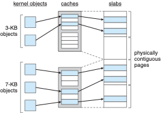
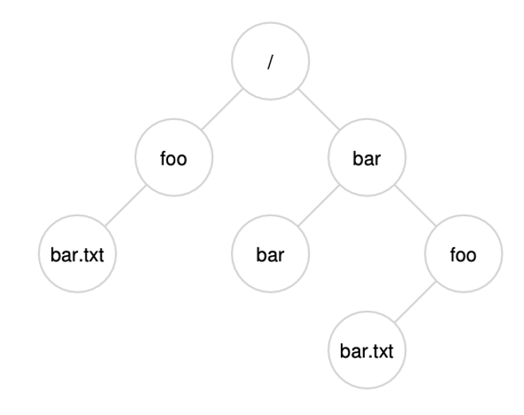

## Admin
:::{.nonincremental}
- Assignment 2 due Wednesday
- Exam 2 regrade request cutoff Wednesday
:::

# Real-World Memory {background-color="#40666e"}

## Questions to consider
:::{.nonincremental}
- How can we increase TLB reach without making the TLB itself larger?
- What memory security features does the OS and hardware provide to protect against attacks?
- Why does a discrete GPU need its own memory, and what changes when CPU and GPU share one pool?
:::

## TLB reach
- We've talked about the hit ratio of a TLB
  - Influenced by the size of the TLB
- Another metric: [TLB reach]{.alert} (i.e., how much memory is addressable from the TLB)
  - Num TLB entries * page size
  - Ideal world: entire working set for a process fits in the TLB
- It'd be great to simply grow the TLB, but that's expensive
- What else can we do?

## Huge pages
- As we discussed, page tables can be large, and TLBs are small. This can lead to a high TLB miss rate, which can significantly degrade performance.
- One solution is to use larger page sizes, known as [huge pages]{.alert}
- By using huge pages (e.g., 2MB instead of 4KB [can go up to 1GB]), we can reduce the number of pages, and thus the size of the page table, and increase the TLB hit rate
- Newer kernels support transparent huge pages, which automatically use huge pages when possible without requiring changes to applications
- Danger: internal fragmentation can be much worse with huge pages, so they are not ideal for all workloads

## Aside: where does a GPU get its memory?
- A graphics card has its own memory chips, called [VRAM]{.alert}
  - Separate chips, separate wires, separate address space
  - So a pointer from your program is [not directly usable]{.alert} by the GPU; data is copied over [PCIe]{.alert} first
  - (Unified virtual memory in CUDA / Linux HMM can share pointers, but the driver still migrates pages over PCIe behind the scenes)
- Why a second pool? VRAM is built for [bandwidth]{.alert}: roughly 10x normal system RAM (GDDR), more with HBM
  - The cost: fixed, small capacity, and data has to cross a slower link (PCIe)
- OS angle: VRAM is *not* part of the pool of frames the kernel hands out

## Unified memory
- Integrated GPUs (Intel, AMD APUs, game consoles) have long shared system RAM: [one]{.alert} pool
- Apple silicon pushes this further: DRAM on the same package as the CPU, with very wide memory buses
  - CPU, GPU, and Neural Engine all share the same physical memory; buffers are shared, not copied
    - because there's nowhere to copy *to*
- Connects to huge pages: [16KB]{.alert} default pages (x86 uses 4KB)
  - For the same number of TLB entries, that's [4x the TLB reach]{.alert}, paid for in internal fragmentation, same as huge pages
- The tradeoff: memory is soldered on-package, so capacity is fixed at purchase, and CPU and GPU compete for the *same* bandwidth

:::{.notes}
Why soldered? It's not just thinness or lock-in — it's what makes the bandwidth possible.

- A standard DIMM channel is 64 bits wide; dual-channel desktop is 128 bits, ~90-100 GB/s.
  Apple runs much wider buses (roughly 128-bit on a base chip up to ~512-bit on a Max),
  which is how you get into the hundreds of GB/s.
- Every one of those bits is a physical wire. You can't route that many traces through a
  socket with good length matching at modern speeds. The width requires the memory to sit
  right next to the controller.
- A socket is also an electrical discontinuity (stubs, reflections), so soldered
  point-to-point traces clock higher. And shorter traces = less energy per bit, which is
  most of why these laptops idle so well.
- Be honest about the other half: it also lets the vendor charge a lot for capacity
  upgrades. Both things are true at once. Good habit of mind: a real engineering
  justification and a convenient business consequence can coexist.
- Apple's is beyond soldered — the DRAM sits on the same *package* as the SoC, not just
  on the motherboard. Two degrees of the same tradeoff.

Backup, if someone asks whether this is a law of nature: no. LPCAMM2 (JEDEC standard,
grew out of Dell's CAMM work) is a socketed LPDDR5X module — it clamps flat against the
board instead of edge-connecting, so signal integrity is much better than SO-DIMM and the
memory is still upgradeable. Doesn't reach Apple-class bus widths, but it shows the
tradeoff is being engineered around.
:::

## Linux memory security
- Linux provides several features to enhance memory security, such as:
  - [Address Space Layout Randomization (ASLR)]{.alert}: randomizes the memory addresses used by a process, making it more difficult for attackers to predict where code or data is located
  - [Kernel Address Space Layout Randomization (KASLR)]{.alert}: randomizes the memory addresses used by the kernel
  - [Non-executable memory (NX)]{.alert}: marks certain areas of memory as non-executable, preventing code from being executed from those regions (e.g., the stack)
    - NX bit: hardware support held in the page table entry
    - (Windows calls this Data Execution Prevention, DEP)

## {background-color="#6E404F"}
::: {.r-fit-text}
What isn't clear?

Comments? Thoughts?
:::

# Kernel memory management {background-color="#40666e"}

## Questions to consider
:::{.nonincremental}
- Why does the kernel need physically contiguous memory, and how does this differ from user-space allocation?
- How does the buddy system handle allocation and deallocation, and what are its trade-offs?
- Why is a slab allocator useful for small, frequently used kernel objects?
:::

## Linux kernel memory management
- Treated differently from user memory: structures of varying sizes, and some must be [physically contiguous]{.alert} (e.g., for device I/O)
- [Buddy system allocator]{.alert}: hand out blocks of size $2^k$
  - Request of size $s$: find the smallest $2^k \ge s$
  - Too big? Split into two "buddies" of size $2^{k-1}$, repeat
  - On free: if the buddy is also free, coalesce back into a larger block

## Buddy system allocator: tradeoffs
- Advantages?
  - Simple and efficient for allocating memory of varying sizes
  - Can quickly coalesce free blocks
- Disadvantages?
  - Fragmentation
    - Internal fragmentation: if a request is for 5KB, we need to allocate an 8KB block, wasting 3KB
    - External fragmentation: over time, as blocks are allocated and freed, we can end up with many small free blocks that cannot be coalesced into larger blocks, making it difficult to satisfy larger allocation requests
  - Not ideal for all workloads, particularly those with many small allocations

## Slab allocator
:::: {.columns}
::: {.column width="45%"}
- Linux also uses a slab allocator for small objects
- Slab allocator maintains caches of pre-allocated memory chunks for frequently used, fixed-size objects (e.g., open-file structs, inodes, process control blocks)
- Modern Linux's implementation is [SLUB]{.alert}
- Allocation is a quick grab from the right cache: less fragmentation, faster small allocations
:::
::: {.column width="2%"}
:::
::: {.column width="53%"}
{width=80%}
:::
::::

## {background-color="#6E404F"}
::: {.r-fit-text}
What isn't clear?

Comments? Thoughts?
:::

# Files {background-color="#40666e"}

## Questions to consider
:::{.nonincremental}
- Why do we need file systems? What problem do they solve?
- What is a file, and what information does the OS need to track beyond just the raw data?
- How should the OS present a file to a program, and why is a flat byte array the dominant abstraction?
- What types of files does Linux support, and how does this differ from file extensions?
:::

## File systems
- We'll talk about actual disks later. But we'll start with files and file systems
- What do you think file systems do?
  - Organize and persist data as files and directories
  - Provide a consistent, simple API no matter how the disk is organized (yet another virtual layer)
  - Protection (e.g., permissions) and safe concurrent access
  - Reliability (e.g., journaling) and good performance
- Objects: files, directories, links, metadata
- Services: naming, hierarchies, locking, allocation, layout, security

## Files
- What is a file?
- Files are the first-class, logical units of data with which processes interact
  - A file is more than the data that constitutes the file
  - What is a file's name?
    - A reference to the file. A file can have multiple names.
  - Its type? Permissions? Owner? Created or last accessed when?
    - These are all examples of metadata, which must persist along with the data
  - Where does the data live on the storage device? How do we update it?
    - The file system decides the block layout; the device may remap it underneath

## File naming
- How do you think names can be leveraged?
- Restrictions on how files are named are up to the OS
- As is the enforcement of extensions (e.g. .c, .exe, .txt)
  - Neither kernel (Windows / Linux) cares for read/write; desktops (Explorer, GNOME/KDE) use extensions to pick a handler
  - The real difference is how "executable" is decided
    - UNIX: permission bit + contents (ELF magic, `#!`)
    - Windows: the extension (`.exe`, `.bat`, `.ps1`) decides *how* it runs; no shebang

## File structures
- How should the OS present a file to a user / program?
- Most commodity OSes represent files as a logically contiguous array of bytes
  - Both a human-readable name and an OS-level identifier (inode)
  - Very flexible from a user/process perspective
- Some files are more heavily structured
  - Mainframes (IBM z/OS): files are sequences of records
  - Object stores (Amazon S3): whole blobs, no in-place rewrites
- Who decides how a file is structured: the OS or the program?

## Linux file types
- What do you think are some example file types from the OS's perspective? (it's not .c, .txt, etc., but more about the underlying structure and semantics of the file)
- In UNIX, there are a few OS-supported file types
  - Regular files: plaintext, images, executables
  - Directories (more on this later)
  - Character devices: `/dev/tty`, `/dev/zero`, `/dev/random`
  - Block devices: `/dev/sda`
  - Symbolic links: the file's data is a path to another file
  - Named pipes (FIFOs) and sockets: endpoints for inter-process communication
- `ls -l` shows the type as the first character: `-`, `d`, `c`, `b`, `l`, `p`, `s`

## File access
- How do we want to access files?
- Early OSes only supported [sequential]{.alert} access (with rewind)
  - This was sensible, because our IO devices (tape, punch cards) were also sequential
- When disks were introduced, this enabled [random]{.alert} access
  - Enables a whole new class of applications and execution models (e.g. databases, virtual memory)

## File operations
- What operations do we want to support on files?
- Common operations:
  - `create`, `open`, `close`, `read`, `write`, `append`, `truncate`, position (`seek`), get attributes, set attributes
- Naming operations (`rename`, `link`, `unlink`) are really operations on *directories*: more on those soon

## {background-color="#6E404F"}
::: {.r-fit-text}
What isn't clear?

Comments? Thoughts?
:::

# Directories {background-color="#40666e"}

## Questions to consider
:::{.nonincremental}
- Why do hierarchical directories solve problems that flat directories cannot?
- What is the difference between a hard link and a soft link?
- What happens when you delete a file that has multiple hard links? A soft link?
:::

## Directories
- Why don't we use a single (flat) directory for all users?
  - Naming problem: each file name must be unique
  - Grouping problem: how to remember what files are mine / relate to my current coding project?
- What if we just had a single directory for each user but stayed flat otherwise?
  - You still have a naming problem. How many `Makefiles` do you have?

## What is a directory?
- [Directories]{.alert} are a special kind of file, whose data are `<name, inode>` pairs, called [directory entries]{.alert} (a.k.a. dirents)
- Typically a directory only stores direct children inodes
- By default, a directory contains `.` (self reference) and `..` (parent)

## Directory structure
:::: {.columns}
::: {.column width="68%"}
- How do we want to structure directories?
- Common approach: a hierarchy (tree)
  - UNIX: a tree starting with root ("/")
- Fixes the single-directory problems
  - Same name in different places; logical organization
- Paths: absolute or relative. Examples?
  - `/home/prs/file.txt` vs. `./file.txt`
:::
::: {.column width="2%"}
:::
::: {.column width="30%"}
{.fragment}
:::
::::

## Directory operations
- What operations do we want to support on directories?
- Common operations:
  - `mkdir`, `rmdir`, `opendir`, `closedir`, `readdir`, `rename`, `link`, `unlink`
- `rename`: remove the old directory entry and add a new one (atomically); the file's data doesn't move
  - Parent directories' modification times change
- `link`: add a new directory entry pointing to the *same* inode
  - The file's data is untouched, but the inode's [link count]{.alert} goes up (and its change time is updated)
- `unlink`: remove a directory entry and decrement the link count

## Hard and soft links
- Who can tell me the difference?
  - [Hard]{.alert}: another directory entry for the same inode
  - [Soft]{.alert}: a separate file whose data is a path
- How do you create them in Linux?
  - `ln target name` vs. `ln -s target name`
- What happens when you delete a hard linked file?
  - Link count drops; data is freed only when it hits 0 (and no process has it open)
- What happens when you delete a soft linked file?
  - Deleting the link leaves the target alone; deleting the target leaves a dangling link
- Hard links can't span file systems or point to directories (keeps the tree a DAG); symlinks can, so they can form cycles

## {background-color="#6E404F"}
::: {.r-fit-text}
What isn't clear?

Comments? Thoughts?
:::