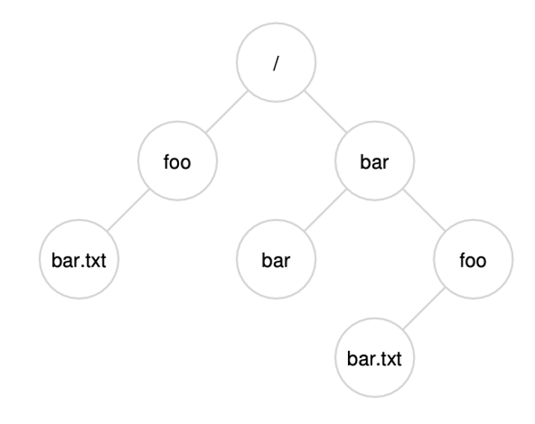
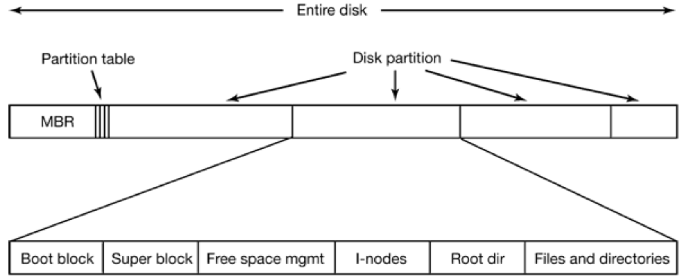
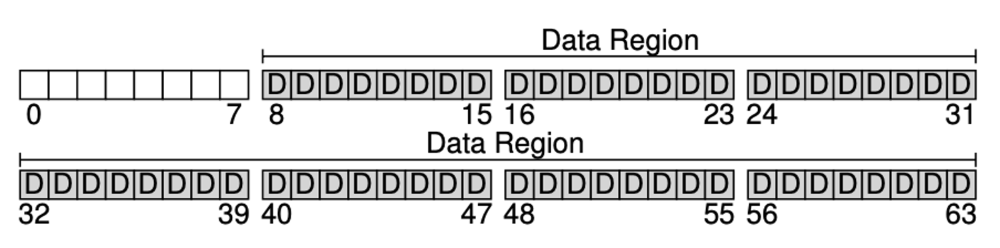
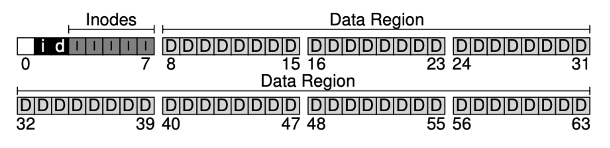
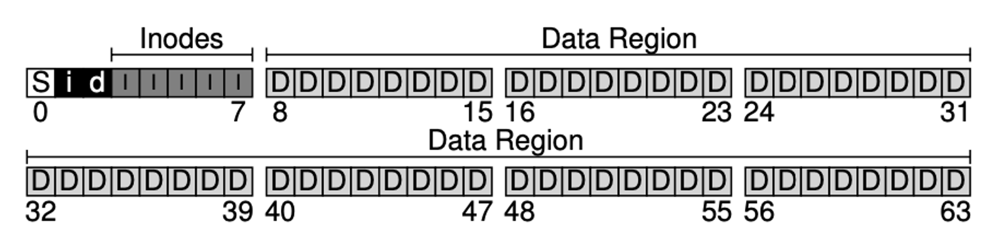
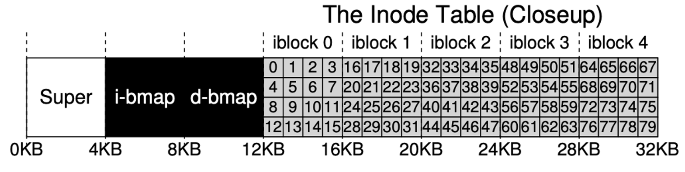
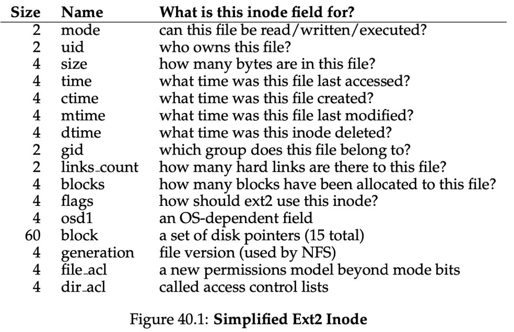

## Admin
:::{.nonincremental}
- Assignment 2 due tonight
- Quiz / Lab, as usual
:::


# Directories {background-color="#40666e"}

## Questions to consider
:::{.nonincremental}
- Why do hierarchical directories solve problems that flat directories cannot?
- What is the difference between a hard link and a soft link?
- What happens when you delete a file that has multiple hard links? A soft link?
:::

## Directories
- Why don't we use a single (flat) directory for all users?
  - Naming problem: each file name must be unique
  - Grouping problem: how to remember what files are mine / relate to my current coding project?
- What if we just had a single directory for each user but stayed flat otherwise?
  - You still have a naming problem. How many `Makefiles` do you have?

## What is a directory?
- [Directories]{.alert} are a special kind of file, whose data are `<name, inode>` pairs, called [directory entries]{.alert} (a.k.a. dirents)
- Only direct children: a path like `/a/b/c` is resolved one component at a time
- By default, a directory contains `.` (self reference) and `..` (parent)

## Directory structure
:::: {.columns}
::: {.column width="68%"}
- How do we want to structure directories?
- Common approach: a hierarchy (tree)
  - UNIX: a tree starting with root ("/")
- Paths: absolute or relative. Examples?
  - `/home/prs/file.txt` vs. `./file.txt`
:::
::: {.column width="2%"}
:::
::: {.column width="30%"}
{.fragment}
:::
::::

## Directory operations
- What operations do we want to support on directories?
- Common operations:
  - `mkdir`, `rmdir`, `opendir`, `closedir`, `readdir`, `rename`, `link`, `unlink`
- `rename`: remove the old directory entry and add a new one (atomically); the file's data doesn't move
  - Parent directories' modification times change
- `link`: add a new directory entry pointing to the *same* inode
  - The file's data is untouched, but the inode's [link count]{.alert} goes up (and its change time is updated)
- `unlink`: remove a directory entry and decrement the link count

::: {.notes}
Demo: watch the link count and ctime change (Linux/GNU `stat`)

- `mkdir demo && cd demo && echo hi > a`
- `stat a`: point out Inode, Links: 1, and the Change time
- `ln a b`, then `stat a` again: same inode, Links: 2, Change time bumped, Modify time unchanged
- `ls -li`: first column is the inode number, third is the link count. `a` and `b` match
- `stat -c '%i %h %n' a b`: compact view (inode, hard links, name)
- `mv b c && ls -li`: inode unchanged, only the name moved. `stat .` shows the directory's Modify time changed
- `rm c` and `stat a`: Links back to 1
- Directories: `stat -c '%h' .` on a fresh dir is 2 (its entry in the parent plus its own `.`). `mkdir sub` bumps it to 3 (the `..` in `sub`)
- Show the syscalls: `strace -e trace=link,linkat,unlink,unlinkat,rename,renameat2 ln a b` (and the same with `rm b`, `mv`)
- macOS: `stat -f '%i %l %N' a b`; `ls -li` works the same
:::

## Hard and soft links
- Who can tell me the difference?
  - [Hard]{.alert}: another directory entry for the same inode
  - [Soft]{.alert}: a separate file whose data is a path
- How do you create them in Linux?
  - `ln target name` vs. `ln -s target name`
- Hard links can't span file systems or point to directories (no cycles); symlinks can, so they can loop

## Predict the links
:::: {.columns}
::: {.column width="52%" .nonincremental}
```{.bash}
echo hello > target
ln target hard
ln -s target soft
ls -li          # (1)
rm target
cat hard        # (2)
cat soft        # (3)
echo bye > target
cat hard        # (4)
cat soft        # (5)
```
:::
::: {.column width="2%"}
:::
::: {.column width="46%" .nonincremental}
- [Think]{.alert}: At (1), which names share an inode, and what is each link count? Predict the output of (2) and (3).
- [Discuss]{.alert}: Compare with a neighbor, then predict (4) and (5). Why do `hard` and `soft` now disagree?
:::
::::

::: {.notes}
Timing: ~2 min think, ~3 min pair, ~3 min share. Then run it live as the reveal (demo below).

Answers:

- (1) `target` and `hard` share an inode, link count 2. `soft` has its own inode, link count 1, type `l`, size 6 (the string "target")
- (2) `hello`: `rm` only removed one name; link count drops to 1, data stays
- (3) `cat: soft: No such file or directory`: the path `target` no longer resolves. Dangling link
- (4) `hello`: `hard` still points at the original inode
- (5) `bye`: `soft` stores a *name*, and that name now resolves to a brand-new inode
- Punchline: a hard link names an inode; a soft link names a path. If no one gets (4)/(5), ask "what exactly does each one store?"
- Data is freed when the link count hits 0 *and* no process has it open (open-but-unlinked bullet below)

Demo: hard vs. soft links

- `echo hello > target && ln target hard && ln -s target soft`
- `ls -li`: `hard` shares `target`'s inode (as in the last demo). `soft` has its own inode, type `l`, and size 6 (the length of the string "target")
- `stat soft` vs. `stat -L soft`: plain `stat` uses `lstat()` and describes the link itself; `-L` uses `stat()` and follows it to the target
- `readlink soft`: prints the stored path. `cat soft`: the kernel follows it
- C side: `stat(path)` follows symlinks, `lstat(path)` doesn't, `fstat(fd)` works on an open file, so it always describes whatever `open()` resolved (the target). `st_ino`, `st_nlink`, and `S_ISLNK(st_mode)` are the fields to print
- `rm target`, then `cat hard` (still works, link count now 1) and `cat soft` (No such file or directory). `ls -l` shows the dangling link, often in red
- `echo bye > target`, then `cat hard` (hello) and `cat soft` (bye). `ls -li` shows `target` has a new inode number
- Open-but-unlinked: `exec 3< hard; rm hard; ls -l /proc/$$/fd/3` shows "(deleted)" yet `cat <&3` still reads it. Data freed when fd 3 closes (`exec 3<&-`)
- Cross-filesystem: `ln /tmp/x ~/x` fails with "Invalid cross-device link" (EXDEV) when /tmp is a separate mount; `ln -s` works. Compare `stat -c %d` (device) on each side
- Directories: `ln somedir d2` fails ("hard link not allowed for directory"); `ln -s somedir d2` works
- Cycle: `mkdir loop && ln -s .. loop/up`, then `ls loop/up/loop/up/loop`. `find -L . ` reports a filesystem loop; plain `find` doesn't follow it
- `strace -e trace=stat,lstat,newfstatat,statx stat soft` shows which call the tool actually makes
:::


## {background-color="#6E404F"}
::: {.r-fit-text}
What isn't clear?

Comments? Thoughts?
:::

# File system structures {background-color="#40666e"}
## Questions to consider
:::{.nonincremental}
- How is a disk partitioned and bootstrapped so the OS can find its file systems?
- What on-disk structures are needed to organize files, and what role does each play?
:::

## Disk layout


## Disk layout (cont'd)
- [Master Boot Record]{.alert} (MBR): sector 0 holds the partition table and boot code
  - BIOS reads MBR, locates the active partition, loads its boot block, and jumps to the OS loader
  - Modern machines: GPT partition table + UEFI firmware, same idea
- File system structures vary by implementation; two major on-disk components:
  - [Metadata]{.alert}: information about files (inodes, bitmaps, superblock)
  - [Data]{.alert}: the actual file contents

## Start with a blank disk
- Divided into blocks, let's say 64 blocks that are 4KB each
- Most of the disk is reserved for [data blocks]{.alert} (storing file contents)


## Metadata blocks
- Metadata about files is stored in [inodes]{.alert}, grouped into an inode table
- We also need to track which blocks are in use: [bitmaps]{.alert} (0 = free, 1 = in-use)
  - One bitmap block for inodes, one for data blocks


## How do we bootstrap the file system?
- When the system starts, how do we figure out how to do things with this file system?
  - Superblock


## Superblock
- The superblock describes the file system as a whole:
  - Type (a magic number identifying e.g. ext4)
  - Block and inode counts (total and free)
  - Locations of the bitmaps, inode table, and data blocks
  - Mount state (clean or dirty)
- Without it the file system can't be mounted, so it's replicated in several places on disk

## {background-color="#6E404F"}
::: {.r-fit-text}
What isn't clear?

Comments? Thoughts?
:::

# Inodes {background-color="#40666e"}
## Questions to consider
:::{.nonincremental}
- What information does an inode store, and why doesn't it include the file name?
- Why can't we just use direct pointers for all files, and how do we solve the problem?
:::

## Inodes
- Each inode tracks metadata about a file, including:
  - Pointers to data blocks associated with the file
  - [Link count]{.alert} (number of directory entries that point to this inode)
  - Permissions, owner and group IDs, file size
  - Timestamps (change, modification, access)
  - (most things available from `stat()`)
- Does **NOT** contain the file name
  - Names live in directory entries, so one inode can have many names (hard links)

## Inodes (cont'd)
- Users see names; the OS works with inode numbers
- Let's imagine inodes are 256 bytes, so we can store 80 in the example 20KB table


## Inodes (cont'd)
:::: {.columns}
::: {.column width="40%"}
- We use the inode to reference the file's data blocks, which are separate from the inode itself
- How should we track the data blocks for a file?
  - One option: direct pointers
    - Any problems with this approach?
:::
::: {.column width="2%"}
:::
::: {.column width="58%"}

:::
::::

## Multi-level pointers
:::: {.columns}
::: {.column width="52%" .nonincremental}
- Direct pointers alone limit file size. The ext2 fix: 15 pointers in the inode
  - 12 [direct]{.alert}: point to data blocks
  - 1 [single indirect]{.alert}: a block of pointers to data blocks
  - 1 [double indirect]{.alert}: a block of pointers to single indirect blocks
  - 1 [triple indirect]{.alert}: one more level
- 4KB blocks, 32-bit (4-byte) block addresses
:::
::: {.column width="2%"}
:::
::: {.column width="46%" .nonincremental}
- [Think]{.alert}: What is the largest file reachable using only direct pointers? Up through single, double, and triple indirect?
- [Discuss]{.alert}: The inode is already in memory. How many disk reads to read the byte at offset 10,000? At 5,000,000? At 5GB?
:::
::::

::: {.notes}
Timing: ~2 min think, ~4 min pair, ~3 min share. Next slide is the answer key for the sizes.

Key fact they need: a 4KB block holds 4096 / 4 = 1024 pointers.

Max sizes:

- Direct: 12 * 4KB = 48KB
- + single: (12 + 1024) * 4KB = 4144KB (~4MB)
- + double: (12 + 1024 + 1024^2) * 4KB (~4GB)
- + triple: (12 + 1024 + 1024^2 + 1024^3) * 4KB (~4TB)

Disk reads (count index blocks + the data block; inode already cached). Block ranges: direct 0-11, single 12-1035, double 1036-1,049,611, triple beyond.

- Offset 10,000: block 2 (10000 / 4096), direct, 1 read
- Offset 5,000,000: block 1220, in the double range, 3 reads (double block, single block, data)
- Offset 5GB (5 * 2^30): block 1,310,720, past 1,049,611, triple range, 4 reads

Follow-up: "Is 4 reads per block a problem?" leads into the next slide (most files are small; caching the index blocks helps for sequential reads).
:::

## Multi-level pointers: answers
- Direct only: $12 * 4KB = 48KB$
- Single indirect: $(12 + 1024) * 4KB = 4144KB$
- Double indirect: $(12 + 1024 + 1024^2) * 4KB = \sim4GB$
- Triple indirect: $(12 + 1024 + 1024^2 + 1024^3) * 4KB = \sim4TB$
- Reads: offset 10,000 needs 1, offset 5,000,000 needs 3, offset 5GB needs 4

## Inodes (cont'd)
- Multi-level pointers support a wide range of file sizes with a fixed-size inode
  - Used by ext2, ext3, and others
- Downside: big files need up to 4 reads per data block (as you just computed). So why is this used?
  - The vast majority of files are *small*, so optimizing for that case is fine

## {background-color="#6E404F"}
::: {.r-fit-text}
What isn't clear?

Comments? Thoughts?
:::

# File system component implementations {background-color="#40666e"}

## Questions to consider
:::{.nonincremental}
- What data structures can be used to implement directories, and what are the trade-offs of each?
- What are the trade-offs between contiguous, linked, and indexed data block allocation?
- What are the options for tracking free blocks, and when does each make sense?
:::

## Directory implementation
- A directory is a file of `<name, inode>` entries; we need to search, add, delete, and rename
- Simplest structure: a linear list
  - Easy to implement
  - Downsides?
    - Lookups are O(n), and we hit directories on every path lookup. Any way to speed it up?
      - Caching: many OSes cache recent directory info
      - Sorted lists / balanced trees: faster search, but keeping them sorted and balanced adds complexity

## Directory implementation (cont'd)
- Hash table: hash the file name to find its entry
  - Pro: no more linear searching
  - Any complications?
    - Collisions are inevitable, so we need chaining or probing
    - Fixed size: past the limit, the table has to grow
  - Why not just use a giant hash table by default?
    - Small tables fit in hardware caches, and most directories are small

## Data block allocation
- Where do a file's blocks go? No single best answer

:::: {.columns}
::: {.column width="33%"}
**Contiguous**

- Pro: fast sequential, simple
- Con: external fragmentation, hard to grow
- *Extents*: runs of blocks
:::
::: {.column width="33%"}
**Linked**

- Pro: no external fragmentation, easy to grow
- Con: slow random access; one bad pointer loses the rest
:::
::: {.column width="33%"}
**Indexed**

- Index block of pointers to data blocks
- The inode scheme from earlier
:::
::::

## Free block tracking
- [Bitmaps]{.alert}: one bit per block (0 = free, 1 = in-use)
  - Space-efficient (32MB for a 1TB drive at 4KB blocks), fast bitwise scanning
  - Used by ext2/3/4, NTFS
  - Con: finding *contiguous* free blocks requires scanning
- Modern large-scale file systems use [extent trees]{.alert} (XFS, Btrfs) or [B-trees]{.alert} (ZFS) that track *runs* of free blocks rather than individual ones

## {background-color="#6E404F"}
::: {.r-fit-text}
What isn't clear?

Comments? Thoughts?
:::